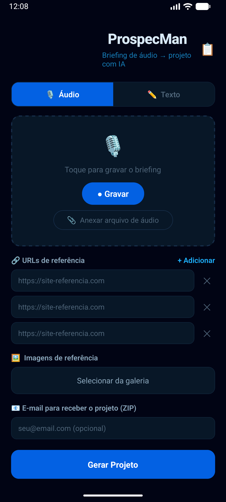
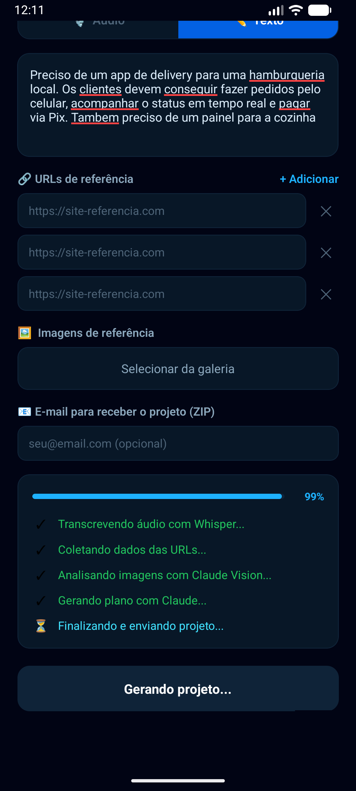
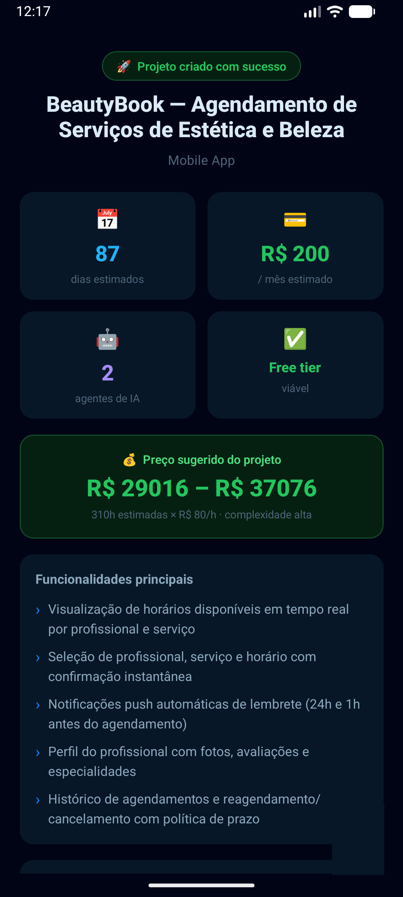
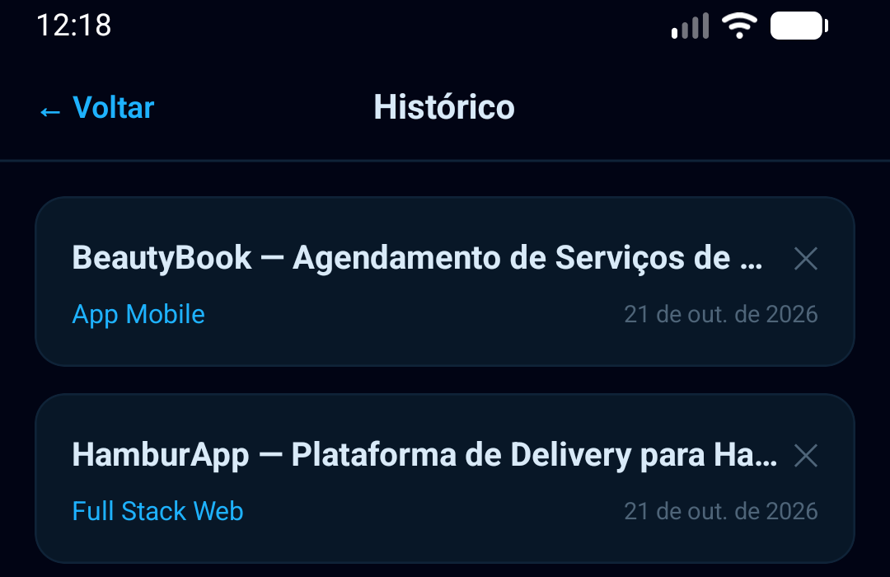

# ProspecMan

**Transforma um briefing de áudio em uma estrutura de projeto completa — arquitetura, stack, cronograma e precificação gerados por IA.**

---

## Sobre o projeto

Fechar um projeto de desenvolvimento normalmente significa gastar horas transformando uma conversa com o cliente em documentação técnica, estimativa de prazo e orçamento. O ProspecMan automatiza essa etapa: o usuário grava (ou digita) o briefing, opcionalmente anexa URLs e imagens de referência, e recebe de volta uma pasta de projeto completa — com arquitetura definida, stack recomendada, cronograma por fases e uma faixa de preço sugerida — pronta para abrir no VS Code e começar a codar.

É voltado para desenvolvedores freelancers e pequenas agências que fazem prospecção de projetos sob demanda e precisam transformar briefings em propostas técnicas rapidamente.

**Status:** em uso real. A API roda em produção no Render e o app mobile (Android) é usado no dia a dia para gerar projetos a partir do celular, de qualquer lugar. O CLI e o web app são usados localmente.

---

## Prévia

| **Tela inicial**<br>Captura o briefing por áudio, texto, URLs e imagens de referência | **Geração com IA**<br>Acompanhamento em tempo real de cada etapa do pipeline |
|---|---|
|  |  |

| **Resultado**<br>Plano técnico, stack recomendada e precificação sugerida | **Histórico**<br>Projetos gerados anteriormente, salvos no dispositivo |
|---|---|
|  |  |

---

## Funcionalidades

**Captura de briefing**
- Gravação de áudio direto no app ou anexo de um arquivo já existente
- Modo texto como alternativa à gravação
- URLs de referência, com scraping automático do conteúdo
- Imagens de referência analisadas por visão computacional

**Geração do projeto**
- Transcrição do áudio com Whisper Large v3 via Groq (gratuito)
- Plano técnico completo gerado por Claude: tipo de projeto, funcionalidades-chave, arquitetura, stack, agentes de IA sugeridos, cronograma por fases e análise de custos
- Precificação sugerida: cálculo determinístico (sem IA), a partir de horas estimadas × valor/hora × multiplicador de complexidade
- Estrutura de pastas criada automaticamente, com 6 documentos markdown detalhados (overview, arquitetura, stack, agentes de IA, cronograma, custos)

**Entrega e acompanhamento**
- Envio automático do projeto compactado (ZIP) por e-mail
- Histórico local dos projetos gerados, com reabertura de resultados anteriores
- Compartilhamento do áudio gravado

**Plataformas**
- CLI para uso local via terminal
- API REST (FastAPI), consumida pelo app mobile e pelo web app
- App mobile Android (Expo), para gerar projetos de qualquer lugar
- Web app (Next.js), para uso local pelo navegador

---

## Arquitetura e stack

| Camada | Tecnologia |
|---|---|
| CLI | Python 3.11, Click, Rich |
| API | FastAPI, Uvicorn, Pydantic v2 |
| Transcrição de áudio | Whisper Large v3 via Groq API |
| Planejamento e visão | Claude (Anthropic) |
| Web scraping | httpx, BeautifulSoup4 |
| Envio de e-mail | smtplib (Gmail SMTP) |
| Web app | Next.js 16, React 19, Tailwind CSS v4 |
| App mobile | Expo SDK 56 (React Native), AsyncStorage |
| Deploy da API | Render (plano free) |
| Build do APK | EAS Build |

O fluxo principal é o mesmo nas três interfaces: o cliente (CLI, web ou mobile) envia áudio/texto, URLs e imagens para o endpoint `POST /api/projects`. A API transcreve o áudio, faz scraping das URLs, analisa as imagens com Claude Vision e envia tudo para o Claude gerar um plano estruturado (JSON validado por Pydantic). A partir desse plano, a API calcula a precificação sugerida, monta a pasta do projeto com os 6 documentos markdown e, se um e-mail foi informado, envia tudo compactado por SMTP. A resposta final (plano, cronograma, custos e precificação) volta para a interface que fez a chamada.

---

## Estrutura do projeto

```
Prospec Man/
├── core/                    # Pipeline de IA, independente de interface
│   ├── audio_transcriber.py     -- transcrição via Whisper/Groq
│   ├── web_scraper.py           -- scraping das URLs de referência
│   ├── image_analyzer.py        -- análise de imagens com Claude Vision
│   ├── ai_planner.py            -- geração do plano do projeto com Claude
│   ├── pricing.py               -- calculate_pricing(): precificação determinística
│   └── project_generator.py     -- cria a pasta e os documentos do projeto
├── api/                     # API REST (FastAPI)
│   └── routes/
│       ├── projects.py          -- POST /api/projects
│       └── health.py            -- GET /api/health
├── web/                     # Web app (Next.js)
│   └── app/, components/        -- formulário e exibição do resultado
├── mobile/                  # App mobile (Expo)
│   ├── App.tsx                  -- navegação: form | result | history
│   ├── screens/                 -- FormScreen, ResultScreen, HistoryScreen
│   ├── components/AudioRecorder.tsx
│   └── utils/storage.ts         -- histórico local e e-mail (AsyncStorage)
├── docs/                    # Documentação do próprio ProspecMan
│   └── portfolio-screenshots/   -- capturas usadas neste README
├── main.py                  # Entrada do CLI
├── config.py                 # Configurações (variáveis de ambiente)
└── render.yaml               # Config de deploy no Render
```

---

## Como rodar localmente

**Pré-requisitos**

| Requisito | Instalação |
|---|---|
| Python 3.11+ | [python.org](https://python.org) |
| Node.js 18+ | [nodejs.org](https://nodejs.org) |
| Chave Anthropic API | [console.anthropic.com](https://console.anthropic.com) |
| Chave Groq API (gratuita) | [console.groq.com](https://console.groq.com) |

**Instalação**

```powershell
# Backend (CLI + API)
.\setup.ps1
.venv\Scripts\Activate.ps1
copy .env.example .env    # preencha as chaves de API

# Web app
cd web
npm install
copy .env.local.example .env.local

# Mobile
cd mobile
npm install
copy .env.example .env
```

**Executar**

```powershell
.\start_api.ps1       # API local (FastAPI)
.\start_web.ps1        # Web app (Next.js)
.\start_mobile.ps1     # App mobile via Expo Go (LAN)

# CLI, direto, sem precisar da API:
python main.py run --audio briefing.mp3 -u https://concorrente.com
```

| Serviço | Porta | URL local |
|---|---|---|
| API (FastAPI) | 8000 | http://localhost:8000/docs |
| Web app (Next.js) | 3000 | http://localhost:3000 |
| Mobile (Expo) | 8081 | QR code exibido no terminal |

---

Do briefing em voz ao kickoff de desenvolvimento, em poucos minutos.
